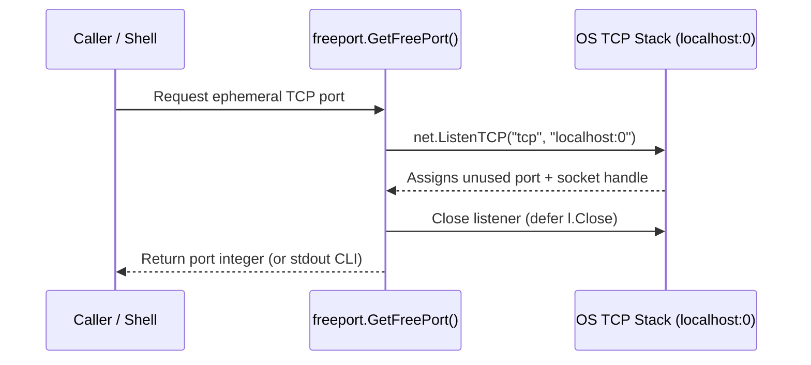

# FreePort

Get free open TCP ports ready to bind in Go libraries, shell scripts, and CI pipelines.

## Port Allocation Flow



## Documentation Portal (Diátaxis)

- **Tutorials:** [CLI and Go Library Quickstart](docs/01-tutorials/index.md)
- **How-To Guides:** [Safe Ephemeral Port Allocation in Go and CI (ASD-STE100)](docs/02-how-to-guides/index.md)
- **Reference:** [Go API, CLI Exit Behavior, and GoReleaser Targets](docs/03-reference/index.md)
- **Explanation:** [Kernel Ephemeral Port Selection & TOCTOU Considerations](docs/04-explanation/index.md)

## Command Line Example

```bash
# Ask the kernel to return an available local TCP port.
export port=$(go run ./cmd/freeport)

# Verify the binary output
echo "Selected port: $port"
```

## Golang Examples

```go
package main

import (
	"fmt"
	"log"

	"github.com/phayes/freeport"
)

func main() {
	port, err := freeport.GetFreePort()
	if err != nil {
		log.Fatal(err)
	}
	fmt.Println(port)

	ports, err := freeport.GetFreePorts(3)
	if err != nil {
		log.Fatal(err)
	}
	fmt.Println(ports)
}
```

## Installation

### Mac OSX

```bash
brew install phayes/repo/freeport
```

### CentOS and other RPM based systems

```bash
wget https://github.com/phayes/freeport/releases/download/1.0.2/freeport_1.0.2_linux_386.rpm
rpm -Uvh freeport_1.0.2_linux_386.rpm
```

### Ubuntu and other DEB based systems

```bash
wget https://github.com/phayes/freeport/releases/download/1.0.2/freeport_1.0.2_linux_amd64.deb
dpkg -i freeport_1.0.2_linux_amd64.deb
```

### Building From Source (Go 1.21+)

```bash
go install github.com/phayes/freeport/cmd/freeport@latest
# Or build locally inside a cloned repository:
go build -o freeport ./cmd/freeport
```
