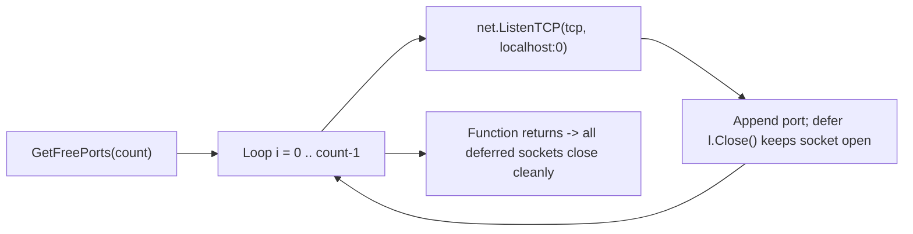

# Kernel Port Allocation & TOCTOU Model

`freeport` delegates port selection to the host operating system kernel instead of probing hardcoded ports sequentially.

## Distinct Multi-Port Allocation (`GetFreePorts`)

## Architecture Trade-Offs

### 1. Why Binding `localhost:0` Outperforms Port Scanning

- Asking the kernel for port `0` immediately selects an unused ephemeral TCP port from the OS ephemeral range (`net.ipv4.ip_local_port_range` on Linux) without generating failed `connect`/`bind` syscalls or hitting ports stuck in `TIME_WAIT`.

### 2. Why `GetFreePorts` Uses `defer l.Close()` Inside the Loop

- Closing each socket inside the loop immediately after reading `l.Addr().(*net.TCPAddr).Port` allows the OS to hand back the same port on the next iteration.
- Because `defer l.Close()` executes at **function return** (not loop iteration end), all `count` sockets stay simultaneously open until all distinct ports are collected.

### 3. Understanding the TOCTOU Window

- Once `GetFreePort` or the `freeport` CLI closes its socket and returns the integer, that port re-enters the OS free pool.
- Between socket closure and the caller's downstream `Listen()` call, another process on the host can claim the same port (Time-Of-Check to Time-Of-Use). Whenever you control the Go server directly, prefer passing a bound `net.Listener` (`net.Listen("tcp", "127.0.0.1:0")`) instead of decoupling discovery from binding.
