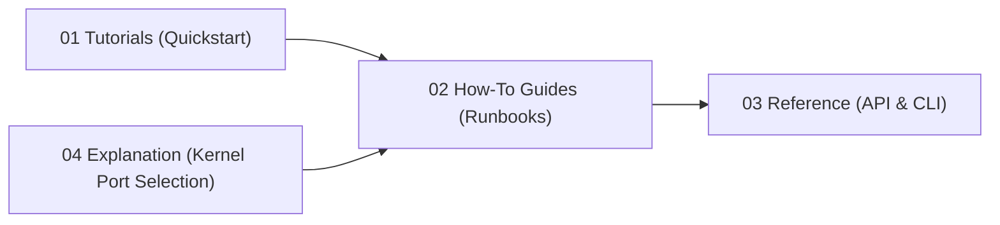

# FreePort Documentation

Structured Diátaxis documentation for `freeport` Go library usage, CLI packaging, safe test integration, and kernel port selection internals.

## Quadrants

| Quadrant | Focus | Entry Point |
| :--- | :--- | :--- |
| **Tutorials** | Guided CLI and Go API quickstart | [Tutorials Index](01-tutorials/index.md) |
| **How-To Guides** | ASD-STE100 operational procedures | [How-To Guides Index](02-how-to-guides/index.md) |
| **Reference** | Exported Go API, CLI, and `.goreleaser.yml` | [Reference Index](03-reference/index.md) |
| **Explanation** | Ephemeral listener lifecycle & TOCTOU design | [Explanation Index](04-explanation/index.md) |

[Back to Repository Overview](../README.md)
